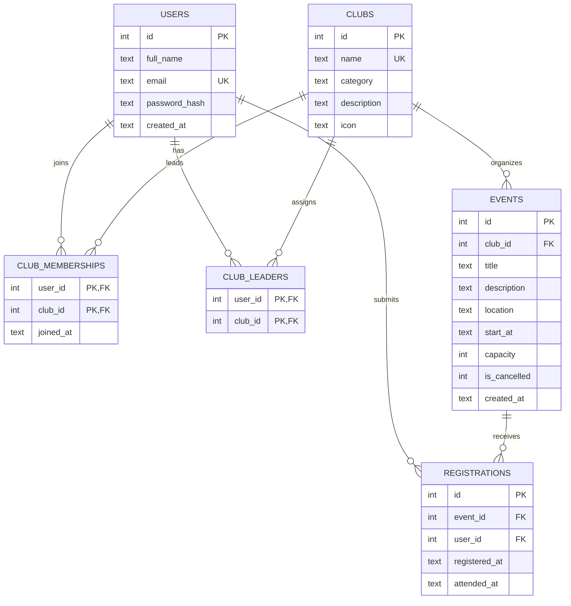

# C. Database Design, Data Dictionary, and D. Normalization

CampusConnect uses relational SQLite tables. Relationships use integer primary and foreign keys; IDs link records without repeating whole user or club details.

## Entity Relationship Diagram (ERD)

### Cardinalities and rationale

- **Club → Event: one-to-many.** One club may publish many events, but each event is created for one club through `events.club_id`.
- **User ↔ Club: many-to-many.** A student can join multiple clubs, and a club can have many members. `club_memberships` resolves that into two one-to-many relationships.
- **User ↔ Club Leader: many-to-many via a junction table.** A user can manage multiple clubs and a club can have multiple authorized leaders.
- **User ↔ Event: many-to-many via `registrations`.** Every registration belongs to exactly one user and one event. The unique `(event_id,user_id)` pair means the same user cannot register twice.

## Data dictionary

| Table | Field | SQLite type | Key / constraint | Purpose |
| --- | --- | --- | --- | --- |
| `users` | `id` | INTEGER | Primary key | Identifies each student/leader |
| `users` | `full_name` | TEXT | NOT NULL | Account display name |
| `users` | `email` | TEXT | UNIQUE, NOT NULL | Login identifier |
| `users` | `password_hash` | TEXT | NOT NULL | Salted hash, not plaintext password |
| `users` | `created_at` | TEXT | NOT NULL | Account creation time |
| `clubs` | `id` | INTEGER | Primary key | Identifies a club |
| `clubs` | `name` | TEXT | UNIQUE, NOT NULL | Club name |
| `clubs` | `category` | TEXT | NOT NULL | Area of interest |
| `clubs` | `description` | TEXT | NOT NULL | Club summary |
| `clubs` | `icon` | TEXT | NOT NULL | Display symbol |
| `club_leaders` | `user_id` | INTEGER | Composite PK, FK → `users.id` | Assigned leader |
| `club_leaders` | `club_id` | INTEGER | Composite PK, FK → `clubs.id` | Club managed |
| `club_memberships` | `user_id` | INTEGER | Composite PK, FK → `users.id` | Student member |
| `club_memberships` | `club_id` | INTEGER | Composite PK, FK → `clubs.id` | Joined club |
| `club_memberships` | `joined_at` | TEXT | NOT NULL | Join timestamp |
| `events` | `id` | INTEGER | Primary key | Identifies an event |
| `events` | `club_id` | INTEGER | FK → `clubs.id` | Organizing club |
| `events` | `title` | TEXT | NOT NULL | Name of activity |
| `events` | `description` | TEXT | NOT NULL | Details of activity |
| `events` | `location` | TEXT | NOT NULL | Where to attend |
| `events` | `start_at` | TEXT | NOT NULL | Event start date and time |
| `events` | `capacity` | INTEGER | 1–10,000 CHECK | Maximum participants |
| `events` | `is_cancelled` | INTEGER | 0/1 CHECK | Cancellation status |
| `events` | `created_at` | TEXT | NOT NULL | Creation timestamp |
| `registrations` | `id` | INTEGER | Primary key | Registration identifier |
| `registrations` | `event_id` | INTEGER | FK → `events.id`; pair UNIQUE | Selected event |
| `registrations` | `user_id` | INTEGER | FK → `users.id`; pair UNIQUE | Student who registered |
| `registrations` | `registered_at` | TEXT | NOT NULL | Registration date/time |
| `registrations` | `attended_at` | TEXT | Nullable | Actual recorded check-in time |

SQLite uses TEXT values for timestamps in this prototype. `UNIQUE(event_id,user_id)` applies jointly to the two registration columns.

## Normalization and integrity (example)

### Before (one unnormalized registration record)

| Event | Club Name | Student Names | Student Emails |
| --- | --- | --- | --- |
| Networking Mixer | Business Club | Alex; Jordan | alex@example.com; jordan@example.com |

This mixes multiple students in a single cell and repeats club information alongside event information. Updating a club name would require modifying event records, and checking attendance for one student would be difficult.

### After (normalized schema)

- `clubs` stores the Business Club name once, under a stable `id`.
- `events` stores each event with a `club_id` reference — not a duplicate club name.
- `users` stores each student's name and email once.
- `registrations` records one row per student's participation in an event. It refers to both `users.id` and `events.id` instead of duplicating names and emails.

This follows the intent of **first normal form** (atomic values), **second normal form** (separate relationships), and **third normal form** (no transitive duplication of club names or student contact details in registrations). The timestamp `attended_at` belongs in `registrations` because it describes an individual person's check-in at a particular event.

### Why keys and integrity constraints matter

- **Primary keys** uniquely identify records; composite keys prevent duplicate memberships.
- **Foreign keys** prevent registration for nonexistent students or events.
- **Uniqueness** on event/student pairs prevents repeat signups.
- **CHECK** constraints reject invalid capacities and statuses.
- **Server-side verification** ensures capacity is not exceeded and only assigned leaders can manage an event.

Schema and constraints are implemented in the `SCHEMA` constant of `app.py`. The relevant route logic appears in `change_registration`, `change_membership`, `event_new`, `event_edit`, and `attendance`.
