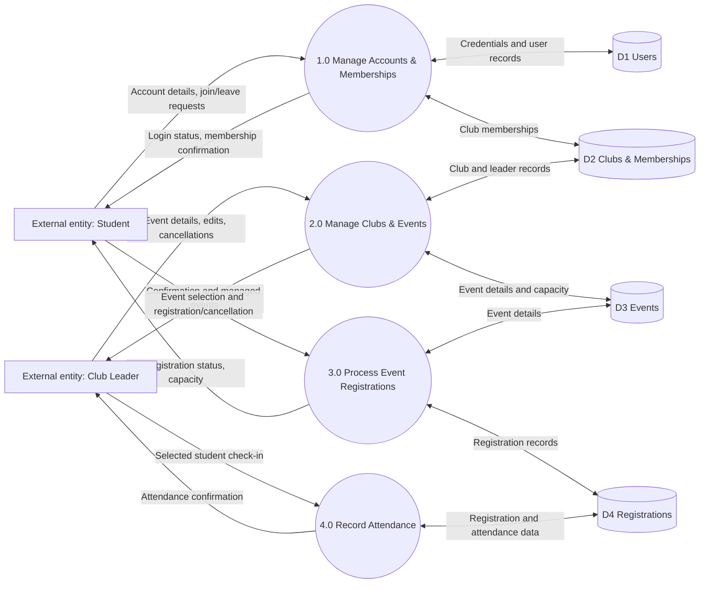

# B. Data Flow Design

## Level 0 Data Flow Diagram

The diagram below captures the flow of data across the main processes. GitHub renders Mermaid automatically in Markdown previews.

## Main components

- **External entities:** Student; Club Leader (both interact through the web interface).
- **Processes:** (1) account/membership management, (2) club/event management, (3) event registration, (4) attendance tracking.
- **Data stores:** D1 users; D2 clubs, club memberships, club leaders; D3 events; D4 registrations.
- **Data flows:** account details, requests to join clubs, new event details, event registration requests, returned confirmation, attendance selections, and persisted records.

## Example: event registration from input to storage

1. The student opens an event detail page and presses **Register for event**.
2. Flask reads the submitted event identifier from the URL and the authenticated user identifier from the session, and verifies the CSRF token.
3. Within a database write transaction, the system checks whether the event exists, is open, still has capacity, and does not already have a registration for this student.
4. On success, SQLite inserts `(event_id, user_id)` into `registrations`. The unique constraint protects against duplicate pairs.
5. Flask commits the transaction and displays a confirmation; the event count and dashboard reflect the stored registration.

**Why this reflects the real system:** each labeled data flow corresponds to a concrete route, submitted form, database query, or response shown to the user.
